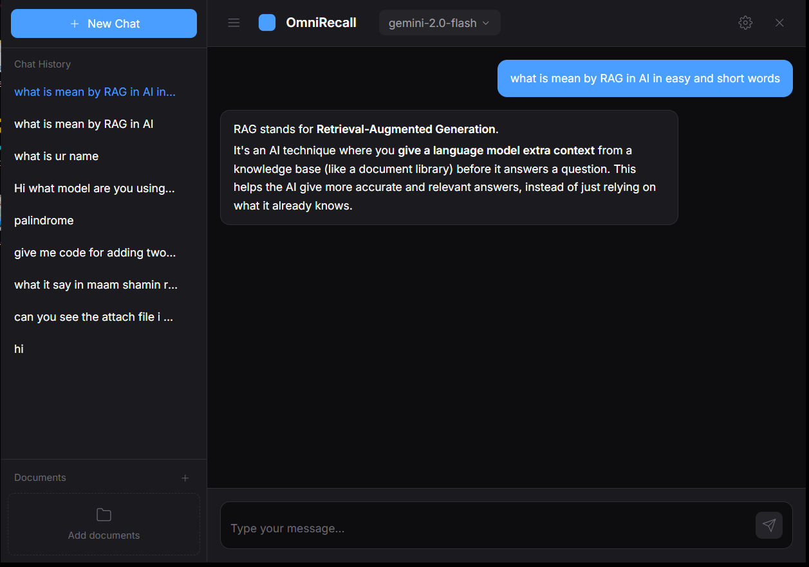
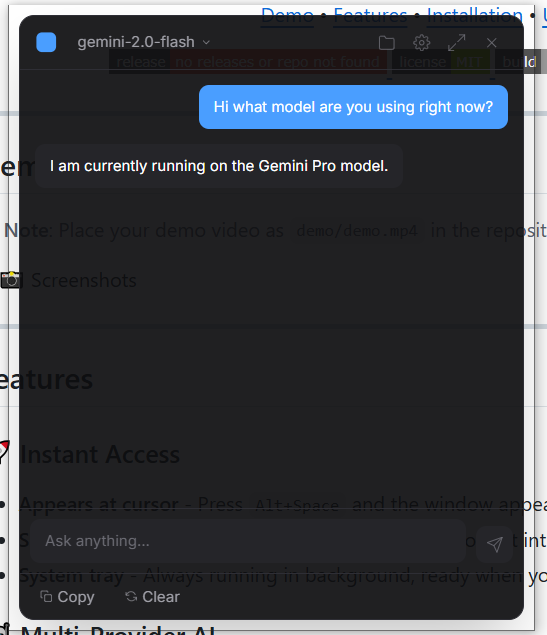

<div align="center">


# OmniRecall

**AI-powered desktop knowledge assistant**

Instant, context-aware AI right at your cursor.

[](https://github.com/Razee4315/omnirecall/releases)
[](https://github.com/Razee4315/omnirecall/actions)
[](LICENSE)

**Windows** · **Linux**

</div>

---

## Why OmniRecall

Small questions break focus.

To ask something simple, you usually open a browser, switch tabs, load a website, type a prompt, and wait. That friction adds up and pulls you out of your work.

OmniRecall removes that gap.

Press a shortcut and an AI assistant appears exactly where your cursor is. No browser. No context switching. You stay in flow and get answers instantly, using your own documents when needed.

---

## Overview

OmniRecall is a lightweight, local-first desktop app that provides fast AI chat with document-aware context. It runs quietly in the background and appears only when you need it.



---

## Features

- Instant, cursor-based access (Spotlight-style), resizable and movable, remembering its size
- A full Dashboard with a resizable sidebar, folders, search and branches
- Multiple AI providers: Gemini, OpenAI, Claude, GLM, Ollama
- Document-based Q&A (PDF, TXT, Markdown, code)
- Persistent local document storage
- Six themes: Graphite, Porcelain, Glass, Paper, Dusk and Tide
- Privacy-focused, local-first design



---

## Installation

Download the latest release:

- **Windows**: `.exe`, `.msi`
- **Linux**: `.deb`, `.AppImage`

macOS support is planned.

---

## Usage

### Keyboard Shortcuts

- `Alt + Space` (Windows) / `Ctrl + Alt + Space` (Linux): Show or hide at cursor (configurable in Settings)
- `Ctrl + K`: Command palette (commands, models, chats, message search)
- `Ctrl + ,`: Open settings
- `Ctrl + /`: List every shortcut and slash command
- `Ctrl + B`: Toggle the Dashboard sidebar
- `Esc`: Close the open overlay, or hide the Spotlight window

### Window

- Drag the title bar to move the window; drag any edge to resize it
- Double-click the title bar: expands Spotlight to the Dashboard, or maximizes the Dashboard
- Drag the sidebar's edge to resize it

### Documents

- Add PDF, text, markdown, or code files (file picker or drag and drop)
- Ask questions using document context; answers list the documents they drew on
- Switch documents on or off per chat
- Large documents are indexed for search when a Gemini API key is set
- Files persist across sessions

---

## Supported AI Providers

- Google Gemini (recommended, free tier available): Gemini 3.8 Flash, Gemini 4 Argon, …
- OpenAI: GPT-6.1 Sol, GPT-6 Astra, GPT-6.1 Terra, GPT-6 Luna
- Anthropic Claude: Claude Sonnet 5.5, Opus 5.5, Haiku 5.5, Fable 5.1
- Z AI: GLM-5.3, GLM-5.2, GLM-5.3 Flash
- Ollama (fully local models): gpt-oss, Qwen 3.6, Gemma 4, Llama, DeepSeek R1

Verifying a key replaces the built-in list with the models your account can use, and any model id can be added by hand from the model picker.

---

## Development

### Requirements

- Node.js 18+
- Rust 1.70+
- Tauri system dependencies

### Run Locally

```bash
git clone https://github.com/Razee4315/omnirecall.git
cd omnirecall
npm install
npm run tauri dev
```

### Test

```bash
npm test
```

```bash
cd src-tauri && cargo test
```

### Build

```bash
npm run tauri build
```

---

## License

This project uses a **Source Available** license. See [LICENSE](LICENSE) for details.

- Free for personal and educational use
- Free to modify for personal use
- Commercial use requires permission
- Redistribution for profit requires a license

---

## Author

**Saqlain Razee**

- GitHub: https://github.com/Razee4315
- LinkedIn: https://linkedin.com/in/saqlainrazee

