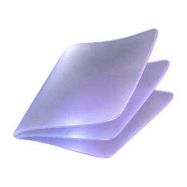
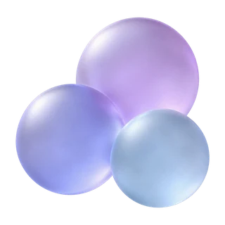

<p align="center">
  <picture>
    <source media="(prefers-color-scheme: dark)" srcset="docs/assets/readme/hero-dark.webp">
    
  </picture>
</p>

<h1 align="center">
  <br>
  OmniRecall
</h1>

<p align="center">
  <b>An AI assistant that appears at your cursor, answers from your own files, and gets out of the way.</b>
</p>

<p align="center">
  <a href="https://github.com/Razee4315/omnirecall/releases/latest"><b>Download</b></a>
  &nbsp;·&nbsp;
  <a href="#features">Features</a>
  &nbsp;·&nbsp;
  <a href="#shortcuts">Shortcuts</a>
  &nbsp;·&nbsp;
  <a href="#build-from-source">Build from source</a>
</p>

<p align="center">
  <a href="https://github.com/Razee4315/omnirecall/releases"></a>
  <a href="https://github.com/Razee4315/omnirecall/actions"></a>
  
  <a href="LICENSE"></a>
</p>

<br>

Small questions break focus. To ask something simple you open a browser, find the tab, type, and wait, and by then you've left your work.

**OmniRecall closes that gap.** Press <kbd>Alt</kbd> + <kbd>Space</kbd> and a quiet window opens right where your cursor is. Ask, read, press <kbd>Esc</kbd>, and you're back where you were.

<br>

## Features

<table>
  <tr>
    <td width="50%" valign="top">
      <br>
      <b>Summoned at your cursor</b><br>
      One shortcut, from any app. A compact window you can move, resize and pin, which remembers how you left it. Expand it to a full Dashboard when you need room.
    </td>
    <td width="50%" valign="top">
      <br>
      <b>Answers from your files</b><br>
      Drop in PDFs, notes, Markdown or code. Large documents are indexed so the relevant passages are found, and each answer lists the files it used.
    </td>
  </tr>
  <tr>
    <td width="50%" valign="top">
      <br>
      <b>Any model, side by side</b><br>
      Gemini, OpenAI, Claude, GLM, or fully local models through Ollama. Switch per message, or compare up to four models on one prompt.
    </td>
    <td width="50%" valign="top">
      <br>
      <b>Private by design</b><br>
      Chats, documents and settings stay on your machine. API keys live in your operating system's credential manager. Nothing goes anywhere except the provider you choose.
    </td>
  </tr>
</table>

Plus branching conversations, folders, full-text search across every chat, a command palette, six themes, and export and backup.

<br>

## How it works

| | | |
| :-- | :-- | :-- |
| **1 · Summon** | **2 · Ask** | **3 · Return** |
| Press <kbd>Alt</kbd> + <kbd>Space</kbd> anywhere. The window opens at your cursor. | Type, or quote the clipboard with <kbd>Ctrl</kbd> + <kbd>Shift</kbd> + <kbd>V</kbd>. Attach files for grounded answers. | Press <kbd>Esc</kbd>. Your chat is saved for next time. |

<br>

## Providers

| Provider | Models out of the box | Key |
| :-- | :-- | :-- |
| **Google Gemini** | Gemini 3.8 Flash · Gemini 4 Argon | [Free tier](https://aistudio.google.com/apikey), also powers document search |
| **OpenAI** | GPT-6.1 Sol · GPT-6 Astra · GPT-6.1 Terra | [API key](https://platform.openai.com/api-keys) |
| **Anthropic** | Claude Sonnet 5.5 · Opus 5.5 · Haiku 5.5 | [API key](https://console.anthropic.com/settings/keys) |
| **Z.ai** | GLM-5.3 · GLM-5.2 | [API key](https://z.ai/manage-apikey/apikey-list) |
| **Ollama** | gpt-oss · Qwen 3.6 · Gemma 4 | None, runs locally |

Verifying a key loads the models your account actually offers, and any model id can be added by hand.

<br>

## Shortcuts

| | |
| :-- | :-- |
| <kbd>Alt</kbd> + <kbd>Space</kbd> | Show or hide, from any app (<kbd>Ctrl</kbd> + <kbd>Alt</kbd> + <kbd>Space</kbd> on Linux; configurable) |
| <kbd>Ctrl</kbd> + <kbd>K</kbd> | Command palette: commands, models, chats, messages |
| <kbd>Ctrl</kbd> + <kbd>N</kbd> | New chat |
| <kbd>Ctrl</kbd> + <kbd>B</kbd> | Toggle the sidebar |
| <kbd>Ctrl</kbd> + <kbd>,</kbd> | Settings |
| <kbd>Ctrl</kbd> + <kbd>/</kbd> | Every shortcut and slash command |
| <kbd>Esc</kbd> | Close an overlay, or hide the window |

Drag the title bar to move the window and any edge to resize it. Double-click the title bar to expand to the Dashboard, or to maximize it.

<br>

## Install

Download the latest build from **[Releases](https://github.com/Razee4315/omnirecall/releases/latest)**.

| Windows | Linux |
| :-- | :-- |
| `.exe` installer or `.msi` | `.deb` or `.AppImage` |

macOS support is planned.

<br>

## Build from source

<details>
<summary>Requirements, running and testing</summary>

<br>

You'll need Node.js 18+, Rust 1.70+, and the [Tauri prerequisites](https://tauri.app/start/prerequisites/) for your platform.

```bash
git clone https://github.com/Razee4315/omnirecall.git
cd omnirecall
npm install
npm run tauri dev      # run the app
```

```bash
npm test                         # frontend tests
cd src-tauri && cargo test       # backend tests
npm run tauri build              # installers
```

</details>

<br>

## License

OmniRecall is **source available**. It's free for personal and educational use and free to modify for yourself. Commercial use or paid redistribution needs permission. See [LICENSE](LICENSE).

<br>

<p align="center">
  <sub>Made by <a href="https://github.com/Razee4315">Saqlain Razee</a> · <a href="https://linkedin.com/in/saqlainrazee">LinkedIn</a></sub>
</p>
